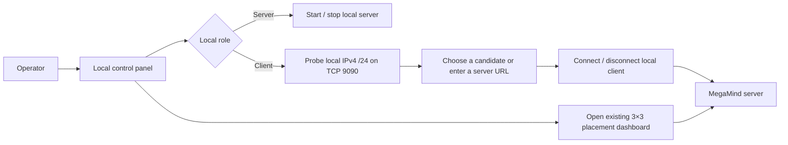
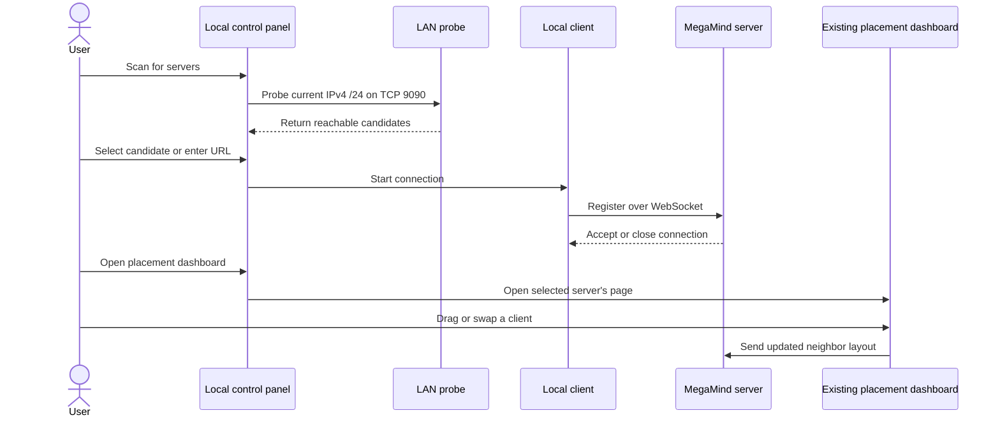

## Request
I want this app to have a GUI to manage the following:
1. Start/Stop of the app
2. Network probing of megamind servers
3. Connecting to megamind servers
4. Managing screen placements

## Refined

### Problem statement and intended outcome
MegaMind currently requires users to start the server or client outside a GUI, use the client's terminal-based LAN scan/selection flow to connect, and open the server-hosted browser dashboard to arrange connected machines. The requested outcome is a local control panel that brings local role lifecycle, server discovery/connection, and access to screen placement management into one non-terminal workflow.

### Working assumptions for review
- The GUI is a local desktop control panel separate from the server-hosted dashboard, so it remains available when the local server is stopped.
- Start/Stop applies only to a local MegaMind server or client instance launched by the panel; it does not start or stop processes on remote machines.
- The panel targets the current Windows and macOS usage supported by the project.
- Discovery preserves the existing client behavior: probe the current machine's IPv4 `/24` for TCP port `9090`, show reachable hosts as candidates, and allow a server address/URL to be entered manually. A reachable port is only a candidate; the connection attempt determines whether it is a usable MegaMind server.
- Screen placements continue to use the existing server-hosted 3×3 dashboard, opened from the panel for the selected server. This scope does not add layout persistence or a second layout editor.

### Acceptance criteria
1. The control panel can be opened and used without interactive terminal prompts. It offers local Server and Client actions and shows the local process/connection state.
2. The user can start and stop a local server or client instance managed by the panel. Status reflects the actual result; startup, permission, and shutdown errors are visible. Stopping the server closes its service and cleans up input-capture resources; stopping the client disconnects it from the server.
3. In Client mode, the user can scan/rescan the current IPv4 `/24` and see hosts with TCP port `9090` reachable. The user can also enter an address manually, including when the scan returns no candidates.
4. Selecting a candidate or entered address connects the local client. The panel shows connecting, connected, disconnected, and failed outcomes; an open port that is not a MegaMind server must not be presented as a successful connection.
5. From the panel, the user can open the selected server's existing placement dashboard. Connected machines can be dragged between 3×3 cells, occupied cells swap as they do today, and the resulting neighbor layout reaches the server. Existing click-to-switch and edge-switch behavior remains unchanged.
6. Existing command-line server/client usage remains supported, and the packaged control-panel entry point is included for the project's Windows and macOS distributions.

### User flow

### Connection and placement flow

### Split recommendation
Split recommendation: NO
Rationale: These controls form one operator workflow—start a local role, discover/connect a server, then arrange machines. Delivering the pieces separately would leave the requested control panel incomplete; existing discovery and placement behavior can be reused within this cohesive task.

## Scope

### Implementation checklist
- [ ] Add a local GUI entry point (provisionally `control_panel.py`) with Server/Client actions, Start/Stop, process and connection status, server scan/rescan, manual address entry, Connect/Disconnect, and an Open Layout action. The GUI framework is intentionally left to implementation.
- [ ] In `client.py`, make the existing subnet probe and connection flow callable by the GUI without terminal input; preserve the current command-line scan, manual-entry, and URL invocation behavior.
- [ ] In `server.py`, support panel-controlled local startup/shutdown with normal FastAPI lifespan cleanup, including stopping the input listeners and Raw Input capture on shutdown.
- [ ] Reuse `static/index.html` and the existing server UI WebSocket behavior for placement management. Open the selected server's dashboard from the panel; preserve the current 3×3 drag/drop, swap, adjacency updates, and force-switch behavior rather than creating a second layout model.
- [ ] Update or add the relevant PyInstaller spec/build targets and `build_windows.ps1` / `build_mac.sh` so the control panel is available in the packaged Windows and macOS distributions; include any GUI dependency in `requirements.txt` only if the chosen framework requires one.
- [ ] Update `README.md` with the GUI start/stop, scan/connect, placement workflow, discovery boundary, and platform permission notes.
- [ ] Add targeted checks for discovery results, manual address entry, connection failures, local process lifecycle/cleanup, and a Windows/macOS end-to-end run through placement and disconnect.

## Log
- audit:state-change at:2026-10-11T18:48:28Z task:TASK-001 from:backlog to:refine action:accept note:"State changed from backlog to refine via accept."
- audit:status-change at:2026-10-11T18:48:32Z task:TASK-001 from:idle to:running action:refine run:rnl6pdj note:"Status changed from idle to running via refine."
- audit:activity-start at:2026-10-11T18:48:32Z task:TASK-001 stage:refine action:refine run:rnl6pdj note:"Started refine activity."
- progress run:rnl6pdj task:TASK-001 at:2026-10-11T18:49:17Z note:"Grounding the GUI request in the existing server, client, and browser control panel."
- run:rnl6pdj task:TASK-001 stage:refine result:ok note:"2026-10-11T18:52:00Z — refined the single-panel workflow, acceptance criteria, assumptions, diagrams, and file-level checklist"
- audit:status-change at:2026-10-11T18:53:42Z task:TASK-001 from:running to:idle action:receipt run:rnl6pdj outcome:ok note:"Status changed from running to idle via receipt."
- audit:activity-finish at:2026-10-11T18:53:42Z task:TASK-001 stage:refine action:receipt run:rnl6pdj outcome:ok note:"2026-10-11T18:52:00Z — refined the single-panel workflow, acceptance criteria, assumptions, diagrams, and file-level checklist"
- audit:state-change at:2026-10-11T19:01:42Z task:TASK-001 from:refine to:scoped action:apply-pending run:rnl6pdj outcome:ok note:"State changed from refine to scoped via apply-pending."
- audit:state-change at:2026-10-11T19:01:44Z task:TASK-001 from:scoped to:approved action:approve note:"State changed from scoped to approved via approve."
- audit:state-change at:2026-10-11T19:01:45Z task:TASK-001 from:approved to:in-progress action:develop note:"State changed from approved to in-progress via develop."
- audit:status-change at:2026-10-11T19:01:45Z task:TASK-001 from:idle to:running action:develop run:rqp4a97 note:"Status changed from idle to running via develop."
- audit:activity-start at:2026-10-11T19:01:45Z task:TASK-001 stage:develop action:develop run:rqp4a97 note:"Started develop activity."
- progress run:rqp4a97 task:TASK-001 at:2026-10-11T19:13:01Z note:"Implemented the local GUI workflow; running unit, local integration, and packaging checks."
- implementation-evidence run:rqp4a97 files:"README.md, build_mac.sh, build_windows.ps1, client.py, server.py, control_panel.py, megamind_control_panel.spec, tests/test_control_panel.py, tests/test_server_lifecycle.py, tests/test_server_client_integration.py" verify:"10 unit and local integration tests passed; Python, Bash, and PowerShell checks and diff whitespace check passed; Windows PyInstaller build succeeded; macOS build and runtime validation unavailable on this Windows host"
- run:rqp4a97 task:TASK-001 stage:develop result:ok note:"2026-10-11T19:15:05Z — implemented the desktop control panel, discovery and stop controls, packaging, documentation, and integration tests; Windows checks passed"
- audit:status-change at:2026-10-11T19:15:38Z task:TASK-001 from:running to:idle action:receipt run:rqp4a97 outcome:ok note:"Status changed from running to idle via receipt."
- audit:activity-finish at:2026-10-11T19:15:38Z task:TASK-001 stage:develop action:receipt run:rqp4a97 outcome:ok note:"2026-10-11T19:15:05Z — implemented the desktop control panel, discovery and stop controls, packaging, documentation, and integration tests; Windows checks passed"
- audit:state-change at:2026-10-11T19:17:33Z task:TASK-001 from:in-progress to:validation action:apply-pending run:rqp4a97 outcome:ok note:"State changed from in-progress to validation via apply-pending."
