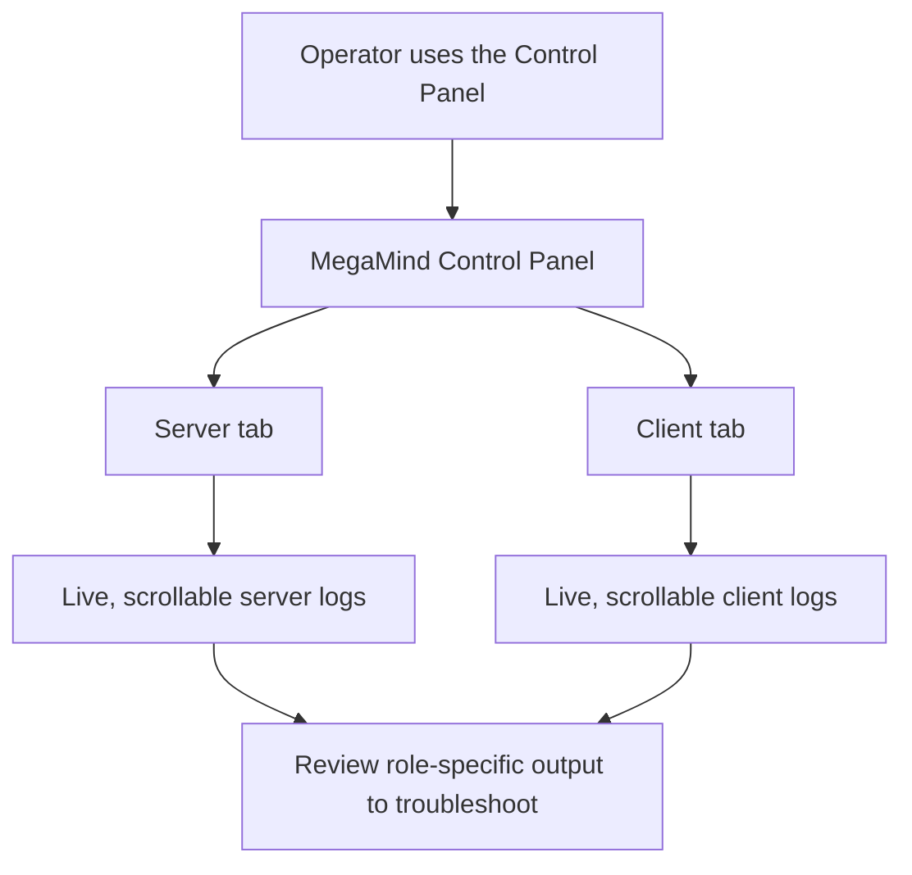

## Request
Control Panel should show logs both for server and client

## Refined

### Problem statement and intended outcome
The desktop Control Panel can start and stop a local server or client and show its status, but it does not show the role's ongoing diagnostic output. A user managing either role from the panel cannot review startup, connection, runtime, or error messages there to troubleshoot problems. The panel should expose separate, live log views for the locally managed server and client so users can inspect each role's output without opening a separate console.

### Assumptions and exclusions
- “Server and client logs” means output from the local instances started by this Control Panel, not logs from a remote server, the browser placement dashboard, or other system processes.
- Capture both standard output and standard error, including existing application and library diagnostics. Keep displayed history in the Control Panel session only; no on-disk persistence, export, filtering, or remote log collection is requested.
- Because the request does not specify placement, use distinct scrollable views in the existing Server and Client tabs so each role's output remains identifiable.

### Acceptance criteria
1. When the Control Panel starts a local server, its startup and subsequent standard-output and standard-error messages appear in the Server tab as they are produced, including warnings and errors.
2. When the Control Panel connects a local client, its startup, connection, retry, disconnect, and error output appears in the Client tab as it is produced.
3. Server and client output remains in its corresponding view even when both roles run concurrently. Each view is scrollable, new output is appended, and stopping a role does not erase its session history; history is not required to survive closing the Control Panel.
4. Streaming output does not make the Control Panel unresponsive or interfere with its existing start, stop, connect, disconnect, status, or close behavior.
5. Logs are visible both when running the source GUI and in the windowed packaged Control Panel, where no console is available.

**Split recommendation: NO** — both role views are required to deliver the single requested outcome, and splitting by role would leave the feature incomplete for one of the two users' managed services.

### Visual behavior

## Scope
- [control_panel.py](control_panel.py): Add distinct, scrollable log views to the existing Server and Client tabs and connect each view to the matching locally managed role.
- [control_panel.py](control_panel.py), [server.py](server.py), and [client.py](client.py): Capture and route both standard output and standard error to the correct role view, including when server and client output is emitted concurrently; ensure windowed builds do not silently discard the captured output.
- [tests/test_control_panel.py](tests/test_control_panel.py): Add coverage for server/client output visibility, standard-output and standard-error capture, correct source separation during concurrent runs, and continued Control Panel responsiveness and lifecycle behavior.
- [README.md](README.md): Document where the two log views appear and clarify that displayed history is limited to the current Control Panel session.
- Validation: Run `python -m unittest discover -s tests -v`; smoke-test the source and windowed packaged Control Panel with the server and client active, confirming both views receive the correct output and the GUI remains responsive.

## Log
- audit:state-change at:2026-10-11T19:28:53Z task:TASK-002 from:backlog to:refine action:accept note:"State changed from backlog to refine via accept."
- audit:status-change at:2026-10-11T19:28:54Z task:TASK-002 from:idle to:running action:refine run:rm7m5lc note:"Status changed from idle to running via refine."
- audit:activity-start at:2026-10-11T19:28:54Z task:TASK-002 stage:refine action:refine run:rm7m5lc note:"Started refine activity."
- progress run:rm7m5lc task:TASK-002 at:2026-10-11T19:30:52Z note:"Refining the local server/client log behavior and implementation checklist."
- run:rm7m5lc task:TASK-002 stage:refine result:ok note:"2026-10-11T19:31:40Z — refined the server/client log criteria, implementation scope, and visual flow; recommended no split"
- audit:status-change at:2026-10-11T19:32:03Z task:TASK-002 from:running to:idle action:receipt run:rm7m5lc outcome:ok note:"Status changed from running to idle via receipt."
- audit:activity-finish at:2026-10-11T19:32:03Z task:TASK-002 stage:refine action:receipt run:rm7m5lc outcome:ok note:"2026-10-11T19:31:40Z — refined the server/client log criteria, implementation scope, and visual flow; recommended no split"
- audit:state-change at:2026-10-11T19:36:41Z task:TASK-002 from:refine to:scoped action:apply-pending run:rm7m5lc outcome:ok note:"State changed from refine to scoped via apply-pending."
- audit:state-change at:2026-10-11T19:36:43Z task:TASK-002 from:scoped to:approved action:approve note:"State changed from scoped to approved via approve."
- audit:state-change at:2026-10-11T19:36:44Z task:TASK-002 from:approved to:in-progress action:develop note:"State changed from approved to in-progress via develop."
- audit:status-change at:2026-10-11T19:36:44Z task:TASK-002 from:idle to:running action:develop run:r1bt0lw note:"Status changed from idle to running via develop."
- audit:activity-start at:2026-10-11T19:36:44Z task:TASK-002 stage:develop action:develop run:r1bt0lw note:"Started develop activity."
- receipt-diagnostic kind:run-mismatch task:TASK-002 expected-run:r1bt0lw expected-stage:develop actual-run:rm7m5lc actual-task:TASK-002 actual-stage:refine note:"Ignored receipt because run id rm7m5lc is stale; expected r1bt0lw."
- run:r1bt0lw task:TASK-002 stage:develop result:blocked note:"no receipt found; awaiting late receipt"
- audit:status-change at:2026-10-11T19:37:29Z task:TASK-002 from:running to:blocked action:missing-receipt run:r1bt0lw outcome:missing-receipt note:"Status changed from running to blocked via missing-receipt."
- audit:activity-finish at:2026-10-11T19:37:29Z task:TASK-002 stage:develop run:r1bt0lw outcome:missing-receipt provisional:true note:"no receipt found; awaiting late receipt"
- audit:status-change at:2026-10-11T19:37:49Z task:TASK-002 from:blocked to:idle action:continue note:"Status changed from blocked to idle via continue."
- audit:status-change at:2026-10-11T19:37:49Z task:TASK-002 from:idle to:running action:continue run:ry4wp84 note:"Status changed from idle to running via continue."
- audit:activity-start at:2026-10-11T19:37:49Z task:TASK-002 stage:develop action:continue run:ry4wp84 note:"Started develop activity."
- progress run:ry4wp84 task:TASK-002 at:2026-10-11T19:39:53Z note:"Planning the role-specific output capture and scrollable log views."
- progress run:ry4wp84 task:TASK-002 at:2026-10-11T19:43:11Z note:"Running the complete test suite and checking the desktop log views."
- implementation-evidence run:ry4wp84 files:"control_panel.py, tests/test_control_panel.py, README.md" verify:"python -m unittest discover -s tests -v passed all 14 tests; source Tk smoke verified separate role views and stream restoration; windowed PyInstaller build succeeded; suppressed-console routing test passed"
- run:ry4wp84 task:TASK-002 stage:develop result:ok note:"2026-10-11T19:45:30Z — added separate live server and client logs with concurrent stdout and stderr capture"
- audit:status-change at:2026-10-11T19:46:26Z task:TASK-002 from:running to:idle action:receipt run:ry4wp84 outcome:ok note:"Status changed from running to idle via receipt."
- audit:activity-finish at:2026-10-11T19:46:26Z task:TASK-002 stage:develop action:receipt run:ry4wp84 outcome:ok note:"2026-10-11T19:45:30Z — added separate live server and client logs with concurrent stdout and stderr capture"
