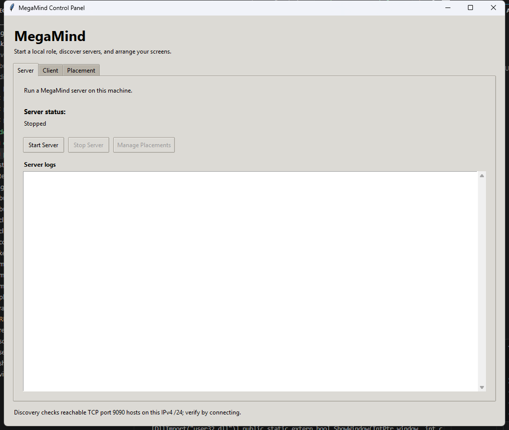
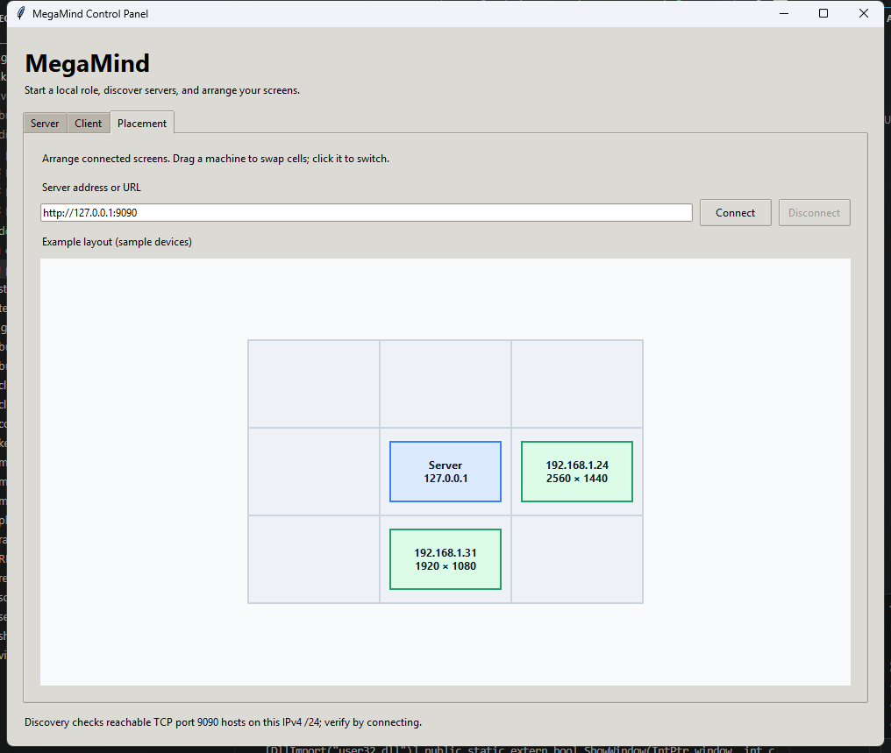

# MegaMind

Control multiple computers (Windows + macOS) with a single keyboard and mouse over your local network — like *Synergy* or *Mouse without Borders*, with a local desktop control panel that includes a native placement editor and a browser-based dashboard.

Move your mouse off the edge of the server's screen and it appears on another machine. Keyboard, mouse, and the text clipboard follow. Arrange machines visually in a 3×3 grid from the desktop panel or a browser.

Vibe-coded using Claude Sonnet 4.6/Opus 4.8.
---

## How it works

```
        ┌─────────────────────────┐         ┌──────────────────────────┐
        │   SERVER  (Windows)     │         │   CLIENT  (macOS / Win)  │
        │  physical mouse + kbd   │         │   receives & injects     │
        │  ┌───────────────────┐  │   WS    │  ┌────────────────────┐  │
        │  │ Raw Input capture │──┼────────▶│  │ Quartz / pynput    │  │
        │  │ pynput suppress   │  │  9090   │  │ injection          │  │
        │  └───────────────────┘  │         │  └────────────────────┘  │
        │  Web UI (FastAPI) ◀─────┼─ browser┘                          │
        └─────────────────────────┘         └──────────────────────────┘
```

- **Server** runs on the machine whose physical keyboard/mouse you control *from*. It captures input, serves the web UI, and forwards events.
- **Clients** run on every other machine. They connect over a WebSocket, register themselves (by IP), and inject the received input locally.
- **Web UI** (served by the server on port 9090) shows all connected machines and lets you arrange them in a 3×3 grid.

> **Server OS:** Windows is the recommended server. It uses the Win32 **Raw Input** API to read true relative mouse motion while the local cursor stays frozen (no drift, no click-leak). A macOS server currently falls back to a less precise capture path.

---

## Features

- **Edge switching** — push the mouse to a screen edge to cross to the neighboring machine.
- **Keyboard + mouse forwarding** — including click-drag and double/triple-click on macOS (native Quartz events).
- **Shared text clipboard** — copy on one machine, paste on another.
- **Multi-monitor aware** — uses the full virtual desktop (all monitors), including monitors positioned left/above the primary.
- **Desktop control panel** — start/stop a local server or client, discover reachable servers, connect manually or from scan results, and arrange screens in a native 3×3 placement editor.
- **Web dashboard** — browser-based 3×3 snap grid to arrange machines; click a machine to force-switch to it.
- **Auto-discovery** — clients self-register by IP; no manual naming.

## Screenshots

### Desktop control panel



### Native placement editor



The placement screenshot uses sample device addresses; a live connection shows the machines registered with the selected server.

---

## Pre-built executables

If you don't want to install Python, grab the standalone binaries from the `dist/` folder:

| File | Platform | Role |
|---|---|---|
| `MegaMind_Server.exe` | Windows | Server — run on the machine with your keyboard/mouse |
| `MegaMind_Client.exe` | Windows | Client — run on every other machine |
| `MegaMind_Control_Panel.exe` | Windows | Desktop GUI to manage local roles and screen placements |
| `MegaMind_Control_Panel.pkg` | macOS | Installer for `/Applications/MegaMind_Control_Panel.app` |
| `MegaMind_Client.pkg` | macOS | Installer for the command-line client |

### Server (Windows)

```powershell
.\dist\MegaMind_Server.exe
```

No arguments needed. It auto-detects your LAN IP and starts on port 9090.

### Client (Windows / macOS)

```powershell
.\dist\MegaMind_Client.exe http://<server-ip>:9090
```

Replace `<server-ip>` with the IP printed by the server on startup.

### Desktop control panel (Windows / macOS)

- **Windows:** run `dist\MegaMind_Control_Panel.exe` (or double-click it). The packaged app requests Administrator permission because local input capture/injection may require elevation.
- **macOS:** install `dist/MegaMind_Control_Panel.pkg`, then open `/Applications/MegaMind_Control_Panel.app`. Grant **Accessibility** permission to the app in `System Settings → Privacy & Security → Accessibility` and relaunch it.

In the **Server** tab, use **Start Server** / **Stop Server** to manage the server on this computer; stopping it waits for input-capture cleanup. **Manage Placements** opens the native Placement tab and connects it to the local server.

In the **Client** tab, **Scan LAN** probes other hosts in the local IPv4 `/24` for reachable TCP port `9090`. Choose a result or enter a host/IP/HTTP(S) URL yourself, then use **Connect** or **Disconnect**. An open port is only a candidate: the client confirms MegaMind registration before reporting connected. **Manage Placements** opens the native editor for the selected server. In the **Placement** tab, you can also enter a server URL directly, drag machine cards to swap screen locations, and click a card to switch control. These controls start and stop only the local instance, not remote machines.

Each tab also includes a live, scrollable log for its local role: server output appears in the **Server** tab and client output in the **Client** tab. Both standard output and errors are shown. Log history remains available until the Control Panel closes and is not saved between sessions.

> **macOS:** Grant **Accessibility** permission to the terminal or app bundle that runs the executable (`System Settings → Privacy & Security → Accessibility`), then re-run.

> **Windows firewall:** Allow inbound port 9090 on the server machine (one-time, elevated PowerShell):
> ```powershell
> New-NetFirewallRule -DisplayName "MegaMind" -Direction Inbound -Protocol TCP -LocalPort 9090 -Action Allow
> ```

Once both are running, use the desktop panel's **Placement** tab or open `http://<server-ip>:9090` in any browser to arrange your machines.

---

## Requirements

- **Python 3.10+** on every machine
- All dependencies are Python packages installed with `pip` (see below)
- **Tkinter** (normally included with Python) for the source-run desktop control panel
- Same local network / subnet for all machines

### About `websockets.exe`

There is **no `websockets.exe` to download.** `websockets` is a Python library that MegaMind installs with `pip` (it's listed in `requirements.txt`). 

When you `pip install websockets`, pip *automatically* creates a small `websockets.exe` launcher in your Python `Scripts\` folder — that's just the package's optional command-line client, and **MegaMind does not use it.** You never need to download or run it.

> ⚠️ Do **not** download a file called `websockets.exe` from any website. Sites offering random `.exe` downloads for Python packages are a common malware vector. The only correct way to get `websockets` is `pip install`.

---

## Installation

On **each** machine:

```bash
# 1. Get the code (copy the folder, clone, or download a zip)
cd megamind

# 2. Install dependencies
pip install -r requirements.txt
```

`requirements.txt` contains:

| Package | Purpose |
|---|---|
| `fastapi`, `uvicorn[standard]` | web server + WebSocket transport |
| `websockets` | WebSocket client (on the client side) |
| `pynput` | keyboard/mouse capture + injection |
| `pyperclip` | clipboard read/write |
| `pyobjc-framework-Quartz` | **macOS only** — smooth, native mouse injection |

### Platform setup

**macOS** (as a client, or server):
- Grant **Accessibility** permission to whatever runs Python:
  `System Settings → Privacy & Security → Accessibility` → add **Terminal** (or iTerm/VS Code), then restart the app.
- For the packaged desktop control panel, grant permission to `MegaMind_Control_Panel.app` and relaunch it.
- `pyobjc-framework-Quartz` installs automatically from `requirements.txt`.

**Windows** (as the server):
- Allow inbound port 9090 through the firewall (run once, elevated PowerShell):
  ```powershell
  New-NetFirewallRule -DisplayName "MegaMind" -Direction Inbound -Protocol TCP -LocalPort 9090 -Action Allow
  ```
- If input suppression/capture misbehaves, run the server terminal **as Administrator**.
- The packaged control panel requests Administrator permission so its local server/client can use input control.

---

## Running it

### Desktop control panel

To launch the native panel from source, run:

```bash
python control_panel.py
```

Use its **Server**, **Client**, and **Placement** tabs to manage the local role and screens. The server tab starts/stops the local server and opens its placement editor; the client tab scans or accepts a manual address and connects/disconnects; the Placement tab connects to a server and provides a native 3×3 grid. Scan results indicate a reachable port, not a verified MegaMind server; a successful registration is required for the Connected status.

On Windows, run the source version as Administrator if input capture/injection is denied. On macOS, grant Accessibility permission to the Python executable or packaged app before connecting.

### 1. Start the server (the machine with the keyboard/mouse you control from)

```bash
python server.py
```

It prints a banner like:

```
============================================================
MegaMind Server
  Local IP     : 192.168.0.129
  Desktop      : 3840x1083 @ (0,-3)
  Web UI       : http://192.168.0.129:9090
  Port         : 9090
  Mouse capture: Raw Input (frozen cursor)
============================================================
```

Note the **Local IP** — clients need it.

### 2. Start a client on every other machine

```bash
python client.py http://192.168.0.129:9090
```

(Use your server's actual IP.) The client auto-registers and appears in the web UI. On macOS confirm the banner says `Inject mode : Quartz CGEvent (smooth)`.

### 3. Arrange screen placements

Use the **Placement** tab in the desktop panel, or visit `http://<server-ip>:9090` in any browser.

- The **server** sits in the center cell of the 3×3 grid.
- **Drag** each connected client into the cell that matches its physical position (LEFT / RIGHT / TOP / BOTTOM). Adjacent cells become neighbors for edge-switching.
- **Click** a machine card to immediately switch control to it.

Now move your mouse to the configured screen edge — control crosses to that machine. Move to the opposite edge on that machine to return.

---

## Verifying / troubleshooting

Run the control-panel and local server/client integration checks with:

```bash
python -m unittest discover -s tests -v
```

Standalone diagnostics are included:

| Command | What it checks |
|---|---|
| `python screens.py` | Prints the detected virtual-desktop bounds (all monitors) |
| `python rawinput_win.py` | (Windows) Prints raw relative mouse deltas — confirms capture works |
| `python test_capture.py` | (Windows) Shows the server's capture/recenter behavior |
| `python test_inject.py` | (macOS) Confirms Quartz cursor injection is smooth |

The automated checks for discovery, connection validation, lifecycle cleanup, native placement interactions, WebSocket layout/force-switch updates, and disconnect behavior are in `tests/` (see the command above).

**Common issues**

- **`[client] Disconnected ([WinError 1225] ... refused)`** — the server isn't running/reachable. Confirm `server.py` is running, the URL uses the server's real LAN IP, port 9090 is open, and both machines are on the same subnet. Test from the client: open `http://<server-ip>:9090` in a browser.
- **Mouse moves on the client but nothing happens on macOS** — Accessibility permission not granted (see Platform setup), then restart the client.
- **Cursor stutters / snaps back on macOS** — `pyobjc-framework-Quartz` not installed; the client banner will say `pynput FALLBACK`. Run `pip install pyobjc-framework-Quartz`.
- **Edge switching does nothing** — make sure the client is placed in a grid cell adjacent to the server in the Placement tab or browser dashboard (this also happens automatically when a client first connects).
- **Clipboard not syncing** — the startup banner shows `Clipboard : unavailable` if `pyperclip` can't reach the clipboard. Run `pip install pyperclip`. (Linux also needs `xclip` or `xsel`.)

---

## Project layout

| File | Role |
|---|---|
| `server.py` | Server: input capture, edge detection, WebSocket + web server |
| `client.py` | Client: connects, injects mouse/keyboard, watches return edge |
| `control_panel.py` | Local desktop GUI for server/client lifecycle, discovery, connection, and native placement editing |
| `placement_grid.py` | Pure helpers for the desktop 3×3 placement editor |
| `rawinput_win.py` | Windows Raw Input mouse capture (relative motion while cursor is frozen) |
| `screens.py` | Cross-platform virtual-desktop bounds (multi-monitor) |
| `clipboard_sync.py` | Cross-platform text clipboard monitor + apply |
| `static/index.html` | Web control panel (3×3 grid UI) |
| `megamind_control_panel.spec` | PyInstaller target for the desktop control panel |
| `tests/` | Discovery, connection, process-lifecycle, placement, and integration checks |
| `requirements.txt` | Python dependencies |
| `test_*.py` | Standalone diagnostics |

---

## Limitations & notes

- **LAN only, no encryption or authentication.** Run it only on a trusted local network.
- **Clipboard is text only** — images and files are not synced.
- **macOS as the server** uses a fallback capture path (the inactive cursor may drift and clicks may reach the server). Windows is the recommended server.
- Switching is one server controlling many clients; clients don't control each other.
